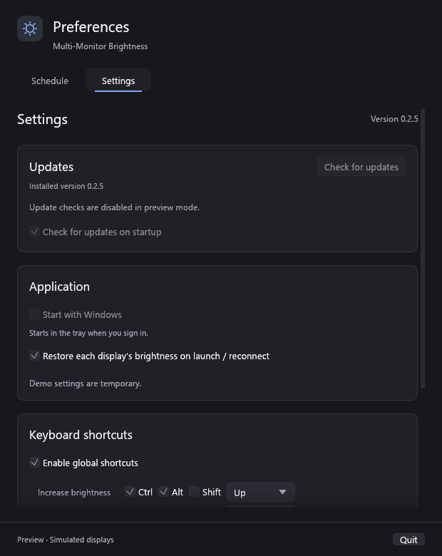

# Rust Auto Updator

Reusable GitHub release updates for portable Windows executables and Ubuntu/Debian packages, with an optional egui panel and shared visual theme. The core is shared by the sibling Rust applications; each product keeps its repository identity, settings, renderer and shutdown lifecycle.

## Ubuntu and Debian packages

Use `Config::debian("owner", "repository", env!("CARGO_PKG_VERSION"), "package-name")`
and release `package-name_VERSION_amd64.deb` (or the configured architecture's
`arm64`/`i386` asset). `SHA256SUMS.txt` can list Windows and Linux assets together.
The optional GitHub asset-digest fallback retains the same explicit opt-in.
Downloads share the Windows pipeline: repository/version binding, cancellation,
bounded streaming, byte count and SHA-256 checks. Linux additionally checks the
Debian package name, version and architecture with `dpkg-deb`.

The running executable must belong to the configured installed Debian package.
Install a source build's first `.deb` manually before enabling this workflow.
`prepare_download_cancellable` only downloads and verifies; it never installs.
Call `handoff` **on a worker thread**, after an explicit install action and saving
host data. It waits for `pkexec apt-get` and the desktop password prompt while
the host remains responsive. On cancellation or failure it returns an error;
keep the host open and retain `Prepared` for retry. On success, close the host.
An unprivileged helper waits for that exact parent process to exit, then starts
the installed executable with the saved arguments and removes its private stage.

```rust,ignore
// Use the host's existing worker/result queue; never block its UI thread.
std::thread::spawn(move || {
    let result = rust_auto_updator::handoff(&mut prepared);
    send_install_result(prepared, result); // Host closes only for Ok(()).
    wake_host();
});
```

Packages require apt, dpkg and `pkexec` (provided by `pkexec` or `policykit-1` on
Ubuntu), plus a desktop polkit authentication agent. The installer forbids apt
removals and gives an existing package-manager operation two minutes to finish.
It never overwrites `/usr/bin` directly and never runs the application as root.
Package-manager failures leave recovery to apt/dpkg; the Windows EXE backup and
startup-health rollback protocol does not apply to Debian packages. The Linux
private staging directory is owned by the current user with mode 0700.

## Separation

| Package / module | Responsibility |
| --- | --- |
| `rust-auto-updator` | Release discovery, semantic versions, HTTPS download, size/SHA-256/PE verification, worker events, workflow state, Windows replacement, Debian package installation and restart |
| `rust-auto-updator-egui` | Update panel and event-loop wake adapter, using the host application's egui theme |
| `rust-auto-updator-egui::style` | Optional light/dark palettes, typography, spacing, theme installation and card container |
| Consuming application | Repository/version/asset configuration, persisted preferences, its own renderer, CLI routing, saving data and exiting before installation |

The core does not depend on egui. The panel never installs a global theme. Applications may use the core with any UI, use the panel with their own theme, or explicitly opt into the supplied light or dark theme. Neither crate owns a window, renderer, tray, settings file, or application event loop.

```text
crates/
  rust-auto-updator/src/
    config.rs      product and installation configuration
    github.rs      repository-bound stable release selection
    verify.rs      checksums and executable validation
    install.rs     staging, helper, replacement, rollback, cleanup
    service.rs     blocking network worker and event channel
    controller.rs  UI-independent update workflow
  rust-auto-updator-egui/src/
    lib.rs         reusable panel and egui wake adapter
    style.rs       optional shared visual system
    localization.rs built-in panel catalogs and stable language codes
```

## Add to another project

Keep this workspace beside the consuming project, then add:

```toml
[dependencies]
rust-auto-updator = { path = "../rust-auto-updator/crates/rust-auto-updator" }
rust-auto-updator-egui = { path = "../rust-auto-updator/crates/rust-auto-updator-egui" }
egui = { version = "=0.37.0", default-features = false, features = ["default_fonts"] }
```

Omit the egui package when building a different UI. This workspace is currently a local dependency, not a published registry or GitHub package. CI must provision the same sibling folder; copying only the consuming repository is insufficient. Once hosted, the path entries can be replaced with Git dependencies pinned to a revision or published package versions.

The workspace requires Rust 1.95, matching the optional egui 0.37 dependency. The Ubuntu implementation was checked locally with Rust 1.95. Windows replacement remains covered by native CI; other Unix installers are not implemented. Include this workspace's [MIT notice](LICENSE) when redistributing its code or linked executables.

## Existing workers and product compatibility

Products with a sleeping background worker can use `check_latest(&config)` and `prepare_download(&release, &config, progress)` directly on that worker instead of creating a nested `Service`. The cancellable variant is `prepare_download_cancellable(&release, &config, &AtomicBool, progress)`. Cancellation is checked before requests, between download reads and before the prepared result; an already blocked network operation remains bounded by its configured timeout. `Service::cancel_download()` provides the same cancellation for the shared worker, and dropping the service cancels its active download.

`Release` exposes the parsed version, notes and release page, plus read-only `executable_name()`, `executable_url()`, `executable_size()`, `checksum_url()` and `sha256_digest()` accessors. `Prepared` owns its staging files until successful handoff; dropping it removes only known staging files. Before handoff, `Prepared::set_restart_args(...)` can persist the host's latest saved document or session arguments.

Product-specific compatibility belongs in configuration:

```rust
# fn example() -> Result<(), String> {
let mut config = rust_auto_updator::Config::new("account", "repository", "1.0.0", "Product")?;
config.asset_suffixes = vec!["-x64".into()];
config.legacy_executable_names = vec!["old-product-{version}-windows-x64.exe".into()];
config.checksum_name = "{executable}.sha256".into();
config.allow_asset_digest = true;
config.expected_subsystem = Some(2); // Require a GUI executable when that is the product's contract.
# Ok(()) }
```

The canonical product filename wins, followed by explicitly configured suffix and historical filename fallbacks. All selected asset URLs remain bound to the exact repository and release tag. Multi-file checksum manifests must name the exact executable; an explicitly configured `{executable}` checksum asset may instead contain one bare SHA-256 digest. Digest-only verification is disabled by default. When enabled it requires a valid GitHub `sha256:` digest; supplied checksum files are still validated and must agree with the digest. A malformed or redirected checksum file never falls back silently. Build metadata alone never triggers reinstallation.

The library owns no renderer, application icon, tray icon or frame loop. Its worker waits on a channel between operations and emits wakes only for actual results or throttled download progress. Hosts must process those events without rendering hidden windows and must supply their own startup-check timer; `Controller::poll` never creates a recurring render timer.

## Host integration

Create a controller once, without making a startup request on the UI thread:

```rust
use rust_auto_updator::{Config, Controller};

fn create_updates(ctx: egui::Context) -> Result<Controller, String> {
    let mut config = Config::new(
        "your-account", "your-repository", env!("CARGO_PKG_VERSION"), "YourProduct",
    )?;
    config.install.restart_args = vec!["--updated".into()];
    config.install.rollback_args = vec![];
    rust_auto_updator_egui::start(config, ctx)
}
```

For another UI, call `Controller::new(config, wake)` and provide a callback that posts an event to that UI. The worker sleeps on its request channel between operations. Its callback must be thread-safe and nonblocking.

On the host's existing logic tick or wake event:

```rust
# fn example(updates: &mut rust_auto_updator::Controller, saved_check_on_startup: bool) {
let event = updates.poll(saved_check_on_startup);
if event.checked {
    // Persist rust_auto_updator::now() if the application tracks last-check time.
}
if event.ready_to_install {
    // Take the prepared update, save settings and finish pending host work.
    // Call handoff(&mut prepared) only after that work succeeds, then exit.
    // A handoff error should be shown with updates.installation_failed(error).
}
# }
```

The host must provide a logic tick after the five-second startup delay, or call `check()` itself when its startup timer fires. `poll` does not create a timer or repaint loop. Pass the persisted startup preference every time; `false` prevents startup requests and leaves manual checks available. No poll call starts a download. A successful manual check suppresses a duplicate startup check for that launch.

Render the panel wherever settings belong:

```rust
# fn example(ui: &mut egui::Ui, updates: &mut rust_auto_updator::Controller, saved_check_on_startup: &mut bool) {
if rust_auto_updator_egui::show(ui, updates, saved_check_on_startup).preference_changed {
    // Save the host application's preferences.
}
# }
```

Initialize the persisted preference to `true` for new installations. For an isolated preview, use `Controller::disabled(version, "Update checks are disabled in preview mode.")`; it creates no network worker.

Optional shared styling is an explicit choice, made once during UI initialization:

```rust
# fn example(ctx: &egui::Context) {
rust_auto_updator_egui::style::apply_dark_theme(ctx);
# }
```

The module also exports palette tokens and `card`. The theme uses the installed Segoe UI font when available and falls back to egui's configured fonts; it does not bundle proprietary fonts. The update panel and `card` use the host's current colors and widget styles.

## Language and appearance

The optional panel includes complete English, Russian, French, German, Spanish and Italian catalogs. Existing `show` calls keep their English behavior. To use a saved interface language, pass it explicitly:

```rust
# fn example(ui: &mut egui::Ui, updates: &mut rust_auto_updator::Controller, saved_startup: &mut bool, saved_language: &str) {
let language = rust_auto_updator_egui::Language::from_code(saved_language);
let response = rust_auto_updator_egui::show_localized(ui, updates, saved_startup, language);
if response.preference_changed {
    // Persist the startup-check preference in the host application's settings.
}
# }
```

Language codes are `en`, `ru`, `fr`, `de`, `es` and `it`; unknown values fall back to English. Regional codes such as `fr-CA` resolve to the base language. Use `Language::ALL` and `native_name()` to build an easily recoverable language selector, then persist `Language::code()`. `show_with_text` also accepts a host-owned `PanelText` catalog. Version templates preserve `{version}`; release notes, product-specific disabled reasons and technical error details remain their original text, with localized status/error headings.

The optional shared style supports an explicit light/dark preference:

```rust
# fn example(ctx: &egui::Context, saved_theme: &str) {
use rust_auto_updator_egui::style::{Theme, apply_theme};
let theme = Theme::from_code(saved_theme);
apply_theme(ctx, theme);
# }
```

Call `apply_theme` once during initialization and when the user changes the preference. Persist `Theme::code()` (`light` or `dark`) in the host settings. `Theme::label(language)` provides localized selector labels; `apply_light_theme` and the existing `apply_dark_theme` are convenience entry points. The old dark palette exports remain available. `palette(theme)` exposes semantic roles for custom controls, and shared cards follow the current host theme.

These functions do not create windows, save preferences, start network requests, poll frames or add timers. The host provides the discoverable Language and Theme controls and saves changes alongside its other settings. The [compiling integration example](crates/rust-auto-updator-egui/examples/integration.rs) shows both selectors updating the panel immediately. Hosts with an existing System theme can continue supplying their own egui visuals and use the localized panel without applying a shared theme.

See [the compiling host example](crates/rust-auto-updator-egui/examples/integration.rs) for the complete save/handoff/error path.

## Required executable protocol

Route these internal arguments before single-instance acquisition, GUI creation, startup checks, or other application side effects:

1. `--apply-update`: call `rust_auto_updator::apply_update(&config)` and exit. The newly downloaded executable acts as the helper. Pass the consuming product's version, not the library version.
2. `--cleanup-update <directory>`: after the updated host initializes successfully, call `cleanup_after_update(directory, config.install.clone())`. Accept the application's configured restart arguments as well.

For Windows installation, take the `Prepared` value after `ready_to_install`, save user data, call `handoff(&mut prepared)`, and exit only if handoff succeeds. The helper waits up to 45 seconds for the original process, verifies that the installed hash has not changed, performs same-volume Windows replacement with a backup, and launches the target with the saved restart arguments plus `--cleanup-update <directory>`. If launching fails, it restores the previous EXE and uses the configured rollback arguments. Dropping a prepared update before handoff cleans its known staging files.

The download must contain this helper protocol. There is no separate always-running updater binary. Keep `stage_prefix`, `helper_name` and the protocol stable between product releases. Only known updater files inside a validated staging folder are removed; settings remain the host's responsibility.

Products that already require healthy-startup rollback can opt in with `config.install.startup_health_timeout = Some(Duration::from_secs(30))`. Call `cleanup_after_update` only after the first successful UI presentation. It verifies the running target and acknowledges that executable's hash; the helper accepts this acknowledgement before cleanup may remove the backup. If the child exits before acknowledgement, the previous executable is restored and restarted. If the child is still running at the timeout, its process and backup are preserved, with a diagnostic `health-timeout.txt` in the staging directory. A timeout or an uncertain process-query result never terminates the child or rolls back beneath a live process. The default policy retains rollback for launch failures without waiting for a first-frame acknowledgement.

For an older product that launched the newly downloaded EXE with positional helper arguments, keep a narrow CLI adapter that validates its historical staging root, filename and argument shape, then calls `apply_legacy_update(&config, target, staged, sha256, parent_pid, ready_marker)`. The shared implementation verifies the helper and staged executable, creates a modern plan beside the installed target and launches the modern helper. A legacy ready marker, when needed, must equal `staged.with_extension("ready")`; it is created after helper launch. Helpers copied from an older installed version already carry their old installer implementation, so those products generally need only their existing restart/cleanup receipt adapter. Do not accept arbitrary legacy paths or duplicate the installer in the host.

Product-specific helper failure reports can use `installation_target(&config)` to resolve a trusted installation target after modern staging, version and helper-hash validation. Portable user-data paths must be derived from that target rather than the helper's staging folder. Keep durable error presentation and the host's existing failure-log format in its small lifecycle adapter.

## Release contract and scope

- Installers: portable single EXE on Windows and dpkg-managed `.deb` packages on Linux. No MSI, macOS, AppImage or archive installer is implemented. `Config::new` retains the Windows contract; Linux clients explicitly choose `Config::debian`. Unsupported configurations fail before installation.
- Stable public GitHub releases with exact `vSEMVER` tags; drafts and prereleases are excluded.
- Default asset: `ProductName-vVERSION.exe` and required `SHA256SUMS.txt` with a SHA-256 line for that exact filename. Compatibility policies above are explicit opt-ins. Download addresses must belong to the configured repository and tag. No GitHub token is needed.
- Set `asset_suffix` to `-x64`, `-x86`, or `-arm64` only for releases offering several architectures. `architecture` controls PE validation independently of the filename. The default follows the consuming target architecture. x64 is exercised by the native smoke regression; x86/ARM64 installation is not runtime-certified.
- HTTPS uses the platform certificate store. Download progress is throttled to roughly 100 ms. Size, checksum, architecture, truncated PE headers/sections, DLL and invalid entry-point failures leave the installed EXE intact. Optional PE subsystem restrictions distinguish GUI from console products. GitHub-provided digests, when present, must agree with the checksum file.
- Default executable limit: 64 MiB. Configure `max_executable_size` for larger products. Checksums detect corruption; this is not an independent release-signing system.
- Downloads and installation require an explicit user action. Startup checks are quiet and do not block launch; the host decides how to indicate an available update outside Settings.
- In-place installation requires a writable executable directory. The library never elevates privileges, changes autostart registration, or chooses where user data is stored.

## Real UI

Historical `v0.1.0` integration screenshot: the shared English panel and dark theme hosted in Multi-Monitor Brightness, captured by the actual CPU/GDI renderer in isolated preview mode. This is the host application's Settings screen, not a separate updater window. It does not demonstrate the new translated catalogs or light palette. New host screenshots and rendered layout checks for these additions remain pending; the library has no standalone window or Settings screen to capture.



## Verification

The [cross-project audit](docs/project-audit-2026-11-01.txt) records the local migration commits, icon checks, Windows rendering measurements and remaining verification gaps for all 23 consuming applications.

On Windows with Rust 1.95 or newer:

```powershell
cargo fmt --all --check
cargo clippy --workspace --all-targets --all-features --locked -- -D warnings
cargo test --workspace --all-features --locked
cargo run -p rust-auto-updator --example native-smoke --features smoke-test --locked -- --test-updater
```

Unit regressions cover semantic version precedence, independent products, explicit legacy filenames and per-asset checksum templates, digest policy, repository binding, ambiguous checksums, corrupted/truncated/wrong-architecture PE files, complete section and entry-point validation, startup opt-out, duplicate requests, cancellation before network activity, process validation, recoverable replacement, rollback after restart failure, live-child preservation on health timeout, acknowledgement before exit and cleanup boundaries. Panel regressions check every catalog for missing text and version placeholders, saved/regional language codes and English fallback, actual egui visual changes across theme switches, and body/secondary text contrast on both palettes. These are source/headless checks, not rendered visual or idle/hidden lifecycle certification for a consuming application. The native smoke example replaces only an isolated executable fixture, waits for process exit, verifies backup and restart, exercises an actual Windows access-denied process query, and verifies rollback when a newly started child exits before startup acknowledgement. It makes no network request and opens no UI. No application window or OS tray exists in this library to verify.

## Source release preparation

The canonical repository is `siarheisinelnikau/rust-auto-updator`. [The current release notes](docs/releases/v0.2.0.md) describe `v0.2.0`; `RELEASE_NOTES.md` preserves the initial `v0.1.0` notes. After committing the source, `./scripts/package.ps1` creates `dist/RustAutoUpdator-v0.2.0-source.zip` with matching release notes, a SHA-256 manifest and MIT notice; it makes no remote request and does not publish to GitHub or crates.io. Each crate also carries its own copy of the MIT notice. The Windows CI workflow runs formatting, strict Clippy, workspace tests and the isolated native replacement/rollback smoke test.

The source-release version is stored in `workspace.metadata.release.version`, independently of the Cargo package versions. Both crates remain `0.1.0` in this source release: the new APIs are additive and no registry package is being published. This preserves existing consumers' local lockfiles and pinned `v0.1.0` integrations. Consumers must explicitly adopt the new source revision to use localized panel APIs or the light theme; existing pins are not silently changed.

Publish the library repository and `v0.1.0` tag before consumer workflows that check out that tag. Startup Manager uses the renderer-independent core with egui 0.33, its own CPU/GDI host, settings store and shutdown lifecycle; it does not require the optional egui 0.37 panel.

## License

MIT. See [LICENSE](LICENSE).
