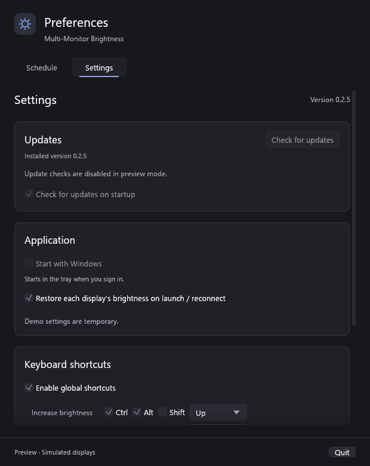

# rust-auto-updator-egui

Reusable update panel for egui 0.37.0, with English, Russian, French, German, Spanish and Italian catalogs and explicitly optional shared light/dark themes. The panel uses the host's existing theme and renderer. Persistent preferences and shutdown remain with the application.

Existing `show` and `apply_dark_theme` entry points remain compatible. Use `show_localized(..., Language)`, `show_with_text(..., &PanelText)` for a host catalog, and `style::apply_theme(..., Theme)` for an optional shared appearance. `Language::native_name()` and `Theme::label(language)` support discoverable selectors; stable `code()` values belong in the host's settings. Apply theme changes only at initialization or when the preference changes. The panel never creates a render timer or global theme.

See the [workspace guide](../../README.md) and [compiling integration example](examples/integration.rs).

Historical `v0.1.0` host Settings screen, rendered with the English shared panel and dark theme in isolated preview mode. New translation/light-theme screenshots remain pending; the library has no standalone window:

